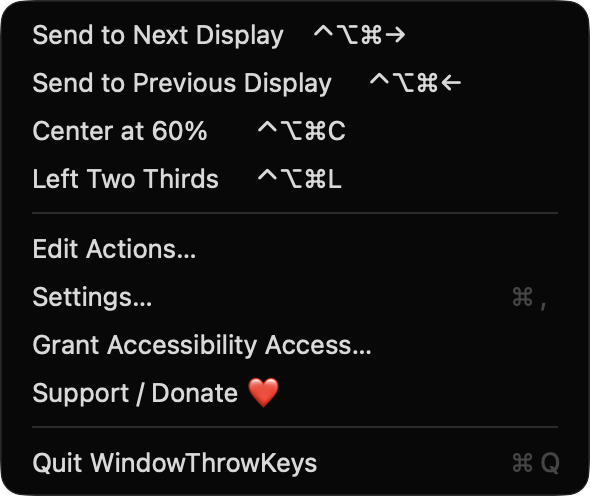
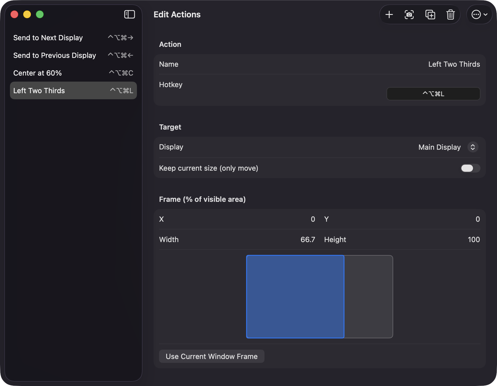
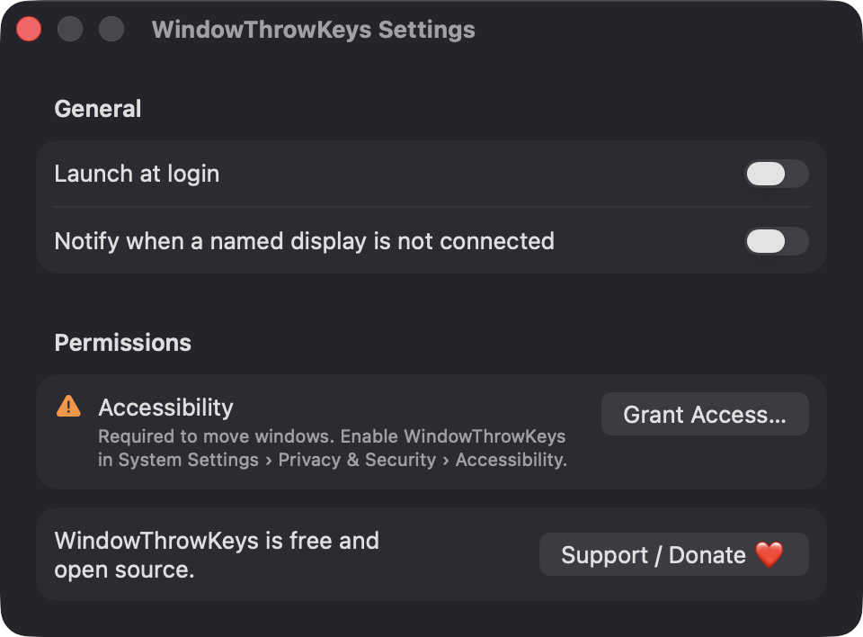

# WindowThrowKeys

**🌐 Website:** [turhe123.github.io/window-throw-keys](https://turhe123.github.io/window-throw-keys/)

Assign a hotkey to throw the front window to a chosen display at an exact position and size.


## Why

WindowThrowKeys is a free, open-source, 100% native, backend-free alternative to paid utilities in the *Window Management* category. It was inspired by Hookshot ($9.99 one-time), which pioneered custom shortcuts that send a window to a specific display, position and size. There is no account, no server and no network code: your actions live in a JSON file on your Mac.

## Features

- **User-defined throw actions**: each has a name, a global hotkey, a target display and a frame.
- **Display targets**: Main, Next, Previous (displays are ordered left to right and wrap around), or a specific display by name. If a named display is not connected, the action falls back to the Main display.
- **Exact frames as percentages** of the target display's visible area (X, Y, Width, Height), clamped so the window never leaves the screen.
- **Keep current size** option: move the window without resizing it. The window is centred in the frame.
- **Capture**: create a new action from the front window's current frame, or fill an existing action with "Use Current Window Frame".
- **Live preview**: a miniature display shows where the frame will land.
- **Hotkey recorder** with conflict warnings when two actions share a shortcut, and a warning if the system or another app already owns it.
- **Starter actions**: Send to Next Display, Send to Previous Display, Center at 60%, Left Two Thirds.
- **Edit tools**: duplicate, reorder, delete, and import/export all actions as JSON.
- **Menu bar app**: lists every action with its shortcut; click one to run it on the front window.
- **Launch at login** via `SMAppService`.
- **Optional notification** when a named display is not connected (off by default).
- Full screen windows are skipped. Windows that can't be resized are moved and kept fully visible.

## Screenshots

<p align="center"></p>

<p align="center"><em>The menu bar menu lists every throw action with its global hotkey click one to send the front window to its display and frame.</em></p>

<p align="center"></p>

<p align="center"><em>The action editor sets each action&#x27;s name, hotkey, target display and frame percentages, with a live preview of where the window will land.</em></p>

<p align="center"></p>

<p align="center"><em>Settings has launch at login, the optional missing-display notification, and the Accessibility permission status.</em></p>

## Install

1. Download `WindowThrowKeys-macOS.zip` from the [latest release](https://github.com/turhe123/window-throw-keys/releases/latest).
2. Unzip it and move `WindowThrowKeys.app` to `/Applications`.
3. The app is open source and not notarized, so macOS will quarantine it. Run:

   ```bash
   xattr -cr /Applications/WindowThrowKeys.app
   ```

4. The first time, right-click the app and choose **Open**.

## Build from source

Requires macOS 14+ and Xcode with Swift 5.9+.

```bash
brew install xcodegen
xcodegen generate
xcodebuild -project WindowThrowKeys.xcodeproj -scheme WindowThrowKeys -configuration Release -derivedDataPath ./build build
```

The app is produced at `build/Build/Products/Release/WindowThrowKeys.app`.

## Permissions

| Permission | Required? | Why |
| --- | --- | --- |
| **Accessibility** | Yes | Used to find the front window and read/set its position and size. The app prompts on launch and shows the status in Settings. Enable it in System Settings › Privacy & Security › Accessibility. |
| **Notifications** | Optional | Only requested if you turn on "Notify when a named display is not connected" in Settings. |
| **Login item** | Optional | Only if you turn on "Launch at login". |

WindowThrowKeys does **not** request Screen Recording or Microphone access, and it makes no network connections. It never reads window contents, only window frames.

## Support ❤️

WindowThrowKeys is free. If it saves you time, you can support its development:

[☕ Support Or (Leo) Davidai ❤️ on Ko-fi](https://ko-fi.com/leodavidai)

The app also has a **Support / Donate ❤️** button in the menu bar menu, Settings and the editor.

## License

MIT © Or Davidai Bachar
